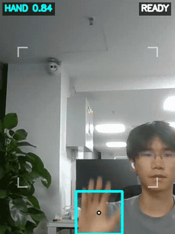

# CV610 端侧四方向手势识别系统 (`hand_direction`)

基于海思 **Hi3516CV610** 平台的实时四方向（`UP` / `DOWN` / `LEFT` / `RIGHT`）手势识别与交互系统，覆盖 **自训练单类手部模型 -> 端侧视觉采集 -> ARMv7 NEON 预处理 -> SVP_NNN NPU 推理 -> 目标跟踪与几何方向状态机 -> JD9853 LCD HUD 可视化 + PWM 方向音效 + 离线连续流消融基准** 的完整闭环。



---

## 1. 系统链路与核心特性

```text
OS04D10 (4M@30fps MIPI)
  -> VI / ISP -> VPSS grp=0 chn=1 (640x360 NV21)
  -> ARMv7 NEON 预处理 (NV21 -> 416x416 FP32 NCHW + Letterbox, prep_ms ~15.4 ms)
  -> SVP_NNN NPU 推理 (hand_detect_static.om, npu_ms ~21 ms, infer_ms ~37 ms, 26-27 Hz)
  -> YOLOv26n 3549 候选框解码 + NMS + 尺度还原
  -> hand_tracker (速度门控 + 自适应 EMA 平滑)
  -> hand_direction (dirv4 几何方向判定: 有效起划修剪 + 667/700 ms 滑窗 + 1.778 横纵比校正)
  -> hand_gesture_engine (中心 80%x60% ROI 门控 + 2000 ms 冷却防回中误触)
  -> 异步渲染 & 音频播报 (JD9853 240x320 SPI LCD HUD + 4 方向 WAV 独立音效)
```

### 核心工程优化
* **推理加速（Track A）**：`src/preprocess.c` 针对 `640x360 NV21 -> 416x416 FP32 NCHW` 实现了 ARMv7 NEON 行转换 + 双行 RGB 缓存复用 + 选择性 padding 初始化；`LIVE_INFERENCE_INTERVAL = 1U` 每帧送入最新帧，异步渲染与推理双线程解耦。
* **交互与防回中调优（Track B）**：
  * 可视区中心 **`80% × 60%` ROI**（640×360 归一化坐标 `(0.330, 0.200)-(0.667, 0.800)`）过滤边缘干扰。
  * `dirv4` 几何识别支持快速起划修剪前置稳态停留点（dwell trim）与横纵比校正（`x_scale = 1.778`），解决“划完冷却期内立即回中”的反向误触发与短距离漏检。
  * LCD HUD 实时显示青色目标框（支持 `HAND_DIRECTION_SHOW_RAW_BOXES=1` 叠加原始框）、轨迹尾迹、中心 ROI、`READY / COOL` 冷却进度条及方向大箭头动画；支持 `gesture_{up,down,left,right}.wav` 独立子进程音频播报。
* **实机数据闭环（Track C）**：
  * 板端支持环境变量无侵入录制检测框 CSV 流（`HAND_DIRECTION_RECORD_PATH` / `HAND_DIRECTION_RECORD_LABEL`）。
  * PC 端 `hand_direction_bench` 支持 `--built-in`、`--split-sessions` 与 `--stream` 连续流逐事件评测（直接对比 `legacy_v1` vs `current_dirv4` 的召回、漏触发、回中反向误触发 `Return FP`、负样本误触发率与 `P50/P95/Max` 时长）。
  * 提供 POSIX / BusyBox `ash` 兼容的 [deploy/soak_monitor.sh](deploy/soak_monitor.sh) 长稳监控脚本（RSS/VSZ/FD/MMZ/帧率）。

---

## 2. 实测性能与消融结果

### 板端实时性能（`OS04D10 -> 640x360 NV21 -> JD9853 240x320`）
* **`prep_ms`**：`14.3–17.5 ms`（稳态 **`~15.4 ms`**，较未优化版本 `21.1–27.5 ms` 显著下降）
* **`npu_ms` / `infer_ms`**：NPU `~21 ms`，单次全推理 `35–39 ms`（稳态 **`~37 ms`**），实际推理速率 **`26–27 Hz`**
* **`display_ms`**：`~52 ms`（`disp_cpu_ms ≈ 5.6–6.6 ms`，`disp_spi_ms ≈ 45.5–46.8 ms`，SPI 25 MHz 异步刷新不阻塞采集推理）

### 实机连续流消融对比（40 次正样本 + 33.4 s 负样本，“框内立即回中”节奏）

| 指标 | `legacy_v1`（旧基线） | `current_dirv4`（当前） | 提升幅度 |
|---|---:|---:|---|
| **正样本总准确率** | 70.0% (28/40) | **90.0% (36/40)** | **+20.0%** |
| `UP` / `DOWN` / `LEFT` / `RIGHT` 召回率 | 70% / 10% / 100% / 100% | **80% / 90% / 90% / 100%** | 下划 **+80%** |
| **正样本漏触发率** | 30.0% (12/40) | **10.0% (4/40)** | **-20.0%** |
| **回中反向误触发（Return FP）** | 9 次 | **1 次** | **-88.9%** |
| **负样本误触发（次 / 次·分）** | 4 (7.19/min) | **1 (1.80/min)** | **-75.0%** |
| **有效划动时长 P50 / P95 / Max (ms)** | 607 / 640 / 644 | **270 / 571 / 671** | **P50 提速 2.2×** |

---

## 3. 仓库结构

```text
hand_direction/
├── CMakeLists.txt                  # Host C11 / CV610 ARM 交叉编译工程配置
├── include/hand_direction/         # 核心模块头文件
│   ├── types.h                     # 检测框、点、方向枚举与事件定义
│   ├── detector.h                  # 检测后端统一抽象
│   ├── preprocess.h                # NV21/RGB -> 416x416 FP32 NCHW & Letterbox
│   ├── postprocess.h               # 3549 候选框解码与 NMS
│   ├── tracker.h                   # 门控与自适应 EMA 跟踪器
│   ├── trajectory.h                # 固定容量时间滑窗轨迹缓存
│   ├── direction.h                 # 四方向几何判定与诊断信息
│   ├── gesture_engine.h            # ROI + 激活 + 采集 + 冷却状态机
│   └── output.h                    # 输出接口
├── src/                            # 核心算法与检测后端实现
│   ├── detector.c / detector_stub.c
│   ├── detector_cv610.c            # CV610 svp_acl NPU 推理后端
│   ├── detector_cv610_placeholder.c
│   ├── preprocess.c                # ARMv7 NEON + 标量快速路径
│   ├── postprocess.c / tracker.c / trajectory.c / direction.c / gesture_engine.c
│   └── output_console.c
├── app/                            # 可执行程序入口
│   ├── live_main.c                 # 板端主程序（双线程推理/显示 + CSV 录制）
│   ├── live_media.c / .h           # OS04D10 VI/ISP/VPSS 640x360 采集管线
│   ├── display_drm.c / .h          # JD9853 DRM RGB565 HUD 渲染与冷却动画
│   ├── audio_announcer.c / .h      # 4 方向独立 WAV 音频子进程播报
│   ├── replay_bench.c              # 离线消融对比基准工具（clip + stream 模式）
│   ├── smoke.c / run_cv610_smoke.sh
│   └── main.c                      # Host stub 仿真 demo
├── tests/                          # 5 项 Host CTest 自动化回归测试
├── audio/                          # 默认及 4 方向提示音效（16kHz Mono PCM WAV）
├── model/                          # CV610 `.om` 模型与静态 ONNX 导出/标定脚本
├── deploy/                         # 自启脚本、长稳监控、整包烧录镜像打包脚本
└── docs/                           # 技术文档与历史补丁归档 (`docs/history/`)
```

---

## 4. 核心算法默认参数（板端实测配置）

| 模块 | 参数 | 值 | 说明 |
|---|---|---:|---|
| 推理与 ROI | `LIVE_INFERENCE_INTERVAL` | `1U` | 每帧相机画面均提交推理线程处理最新帧 |
| | 中心有效区 ROI | `80% × 60%` | 可视区域中央，归一化 `(0.330, 0.200)-(0.667, 0.800)` |
| 跟踪器 (`tracker.c`) | `ema_alpha` / `lost_timeout_ms` | `0.35` / `250 ms` | 基础平滑系数与丢检复位时间 |
| | `max_speed` / `max_step_norm` | `3.2 /s` / `0.38` | 跳点过滤与速度自适应关联门限 |
| 方向识别 (`direction.c`) | `window_ms` / `min_span_ms` | `700 ms` / `220 ms` | 轨迹时间窗口与最小有效跨度 |
| | `min_samples` / `confirm_count` | `6` / `2` | 最少有效样本点与连续确认帧数 |
| | `min_displacement` / `min_speed` | `0.12` / `0.20 /s` | 最小归一化位移与平均速度 |
| | `min_linearity` / `axis_ratio` | `0.82` / `1.65` | 直线度与主/次轴比门槛 |
| | `x_scale` | `1.778` (`640/360`) | 统一 X/Y 物理长宽尺度 |
| | `min_segment_consistency` / `min_half_cosine` | `0.75` / `0.65` | 分段方向一致性与半程夹角门限 |
| 状态机 (`gesture_engine.c`) | `activation_confidence` / `confirm` | `0.60` / `2 frames` | 激活阈值与连续确认帧数 |
| | `cooldown_ms` / `event_animation_ms` | `2000 ms` / `1000 ms` | 冷却防回中时间与箭头显示时长 |

---

## 5. Host 编译、测试与离线回放（PC / WSL）

```bash
cd hand_direction
cmake -S . -B build-host -DCMAKE_BUILD_TYPE=Release
cmake --build build-host --parallel
ctest --test-dir build-host --output-on-failure -V
./build-host/hand_direction_demo
```

`ctest` 包含 5 项全通过测试：`direction`、`gesture_engine`、`preprocess`、`postprocess`、`replay_bench`。

### 离线基准工具 `hand_direction_bench` 用法
```bash
# 1. 运行内置 130 条合成基准（正样本 + 负样本）
./build-host/hand_direction_bench --built-in

# 2. 按框内“触发 -> 冷却期立即回中 -> 等待 READY”连续录制流评测
./build-host/hand_direction_bench --stream \
  board_up.csv=10 \
  board_down.csv=10 \
  board_left.csv=10 \
  board_right.csv=10 \
  board_neg.csv \
  --markdown board_ablation_report.md

# 3. 对无明确分割的长流按断手间隔 (>=1200ms) 自动切分片段评测
./build-host/hand_direction_bench --split-sessions <csv_or_dir>...
```

---

## 6. 板端环境变量与部署

`cv610_live_hand <model.om>` 支持以下环境变量：

| 环境变量 | 说明 |
|---|---|
| `HAND_DIRECTION_RECORD_PATH` | 启用检测框/耗时轨迹 CSV 录制（追加写入，格式 `hand_direction_record_v1`） |
| `HAND_DIRECTION_RECORD_LABEL` | 写入 `# clip label=<UP\|DOWN\|LEFT\|RIGHT\|NONE>` 供离线回放自动打标 |
| `HAND_DIRECTION_DISABLE_DISPLAY` | 设置后禁用 DRM/LCD 输出（纯无头推理或性能对比） |
| `HAND_DIRECTION_SHOW_RAW_BOXES` | 设为 `1` 时在 LCD 叠画红色原始未平滑框与 `EMA` 框对比 |
| `HAND_DRM_DEVICE` | 指定 DRM 设备节点（默认 `/dev/dri/card0`） |
| `HAND_GESTURE_SOUND` | 默认音频路径（如 `/root/hand_direction/audio/gesture_effect.wav`，程序自动查找同目录 `gesture_{up,down,left,right}.wav`）；设为 `off`/`0`/`none` 静音 |
| `HAND_GESTURE_SOUND_PLAYER` | 音频播报辅助进程路径（默认 `/root/hand_direction/bin/cv610_gesture_sound`） |

更多细节请查阅：
* 完整开源实战案例长文（含自训练 YOLO26n 与踩坑总结）：[docs/case-study.md](docs/case-study.md)
* 模型与前后处理接入：[docs/model-integration.md](docs/model-integration.md)
* 实机评测、录制与长稳监控：[docs/benchmark-and-deployment.md](docs/benchmark-and-deployment.md)
* 镜像打包与开机自启：[deploy/README.md](deploy/README.md)
* 模型转换与标定说明：[model/README.md](model/README.md)
