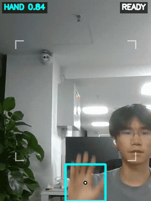
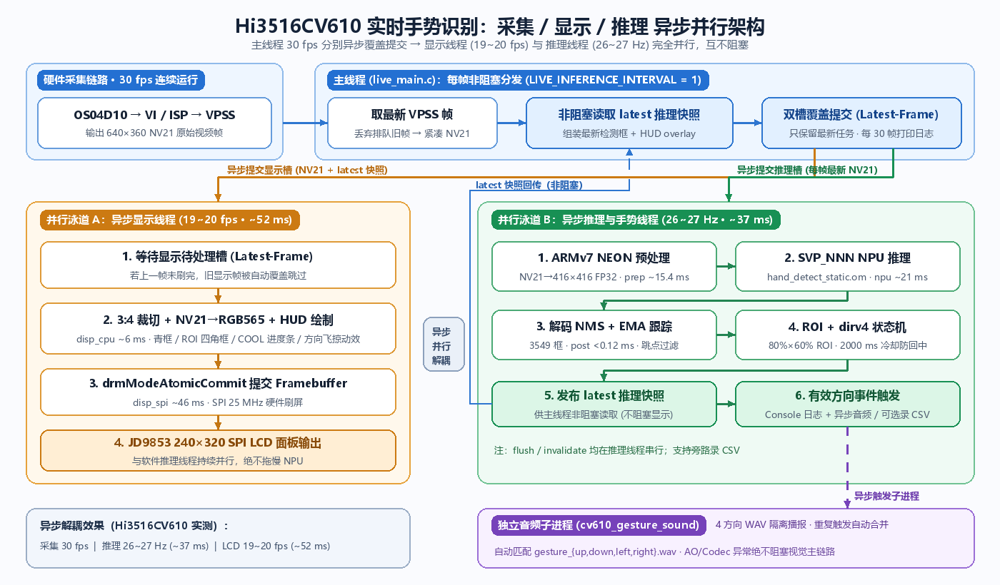

# 【CV610 动态手势案例】在 Hi3516CV610 上实现 27 Hz 实时动态四方向手势识别：自训练 YOLO26n、NEON 加速、防回中状态机与实机消融闭环

- **开源仓库**：https://github.com/879Heisenberg/cv610-hand-direction-dynamic
- **预编译交付件（Release v1.0.0）**：https://github.com/879Heisenberg/cv610-hand-direction-dynamic/releases/tag/v1.0.0
- **硬件平台**：Hi3516CV610（ARM Cortex-A7，musl Linux，`hi_aiot_solution`）、板载 OS04D10 4M@30fps MIPI 摄像头、JD9853 240×320 SPI LCD、板载音频输出
- **项目目标**：不依赖重型 21 点关键点或时序神经网络（LSTM / 3D-CNN），在极度轻量化的 CV610 上仅通过**自训练单类静态手掌检测 `.om` + 纯 C11 物理几何轨迹状态机**，通过优化榨干 cv610 开发板性能，实现低延迟、高鲁棒性的端侧实时四方向（`UP / DOWN / LEFT / RIGHT`）动态手势交互与声画反馈

### 演示效果（JD9853 240×320 3:4 竖屏 HUD 实测链路回放：up）

### 核心实测指标一览
- **实时推理**：NPU 推理约 **`21 ms/帧`**，ARMv7 NEON 预处理约 **`14.3–17.5 ms`（稳态 `~15.4 ms`）**，总推理约 **`35–39 ms`（稳态 `~37 ms`，26–27 Hz）**；后处理 `<0.12 ms`。
- **采集与显示**：相机采集稳跑 **`30 fps`**，SPI LCD 异步渲染约 **`19–20 fps`**（`disp_cpu_ms ~6 ms`，`disp_spi_ms ~46 ms`，不阻塞采集与推理）。
- **模型体量**：`hand_yolo26n.pt (5.36 MB)` → `hand_yolo26n_416_static.onnx (9.70 MB)` → **`hand_detect_static.om (3.18 MB)`**，`aicpu_buf_size = 0`（100% 纯 NPU 零回退执行）。
- **实机连续流消融（40 次“框内立即回中”正样本 + 33.4 s 负样本）**：
  - 正样本总准确率：`70.0% (28/40)` → **`90.0% (36/40)`**（下划召回 `10% → 90%`）
  - 回中反向误触发（Return FP）：`9 次` → **`1 次`（-88.9%）**
  - 负样本误触发率：`7.19/min` → **`1.80/min`（-75.0%）**
  - 有效划动中位响应时长（P50）：`607 ms` → **`270 ms`（提速 2.2×）**

---

## 一、本案例真正解决的问题

在海思轻AI越影生态中，CV610 常见案例多聚焦在**单帧静态视觉任务**（如抓拍、目标/人脸检测、RTSP 推流，典型推理耗时 50–90 ms/帧、检测帧率 6–15 FPS）。而在百元级、轻内存、无独立 GPU 的 CV610 上做**实时动态手势识别**，一直存在天然瓶颈：传统“手部关键点 + 时序模型”算力吃紧，而简单用静态框算位移又会暴露出 **NPU 算子回退、CPU 预处理拖垮帧率、SPI 屏阻塞采集、快速挥手出现“蜘蛛网”跳点、划完回中疯狂误触发反方向** 等一系列工程问题。

本案例不是“把现成模型转成 `.om` 框出手掌”就结束的 Demo，而是打通了 **数据集构建与自训练 → 多分辨率选型与静态算子裁剪 → NEON 预处理加速 → 异步双线程解耦 → 防回中几何状态机 → 实机录流离线消融** 的全栈闭环，在极度轻量化的 CV610 上做出了 **26–27 Hz 实时感知与 270 ms 级中位响应** 的开创性端侧动态交互成果。

---

## 二、自训练 YOLO26n 单类手部模型：从数据构建到 CV610 上板

### 1. 为什么自训练“单类手部框”而不直接用多类静态手势模型
通用或样例手势模型通常输出多个静态手势类别（`fist / ok / palm / like / dislike`），在快速动态挥手时手掌因透视与运动模糊极易在类别间跳变，导致轨迹断裂。本方案将所有手部形态统一标注为**单类别 `0: hand`**，不区分左右手和开合状态——让 NPU 专注做最轻、最稳的手部定位，把四方向动态识别完全交给后级 C11 物理几何状态机。

### 2. 数据集构建与质量校验
- **多源合并与分层抽样**：合并 `COCO-Hand-Big`（自然场景与小尺度目标）和 `HaGRIDv2` 的 `fist / palm / stop / stop_inverted` 四类（覆盖近距手掌、握拳、侧翻姿态），全部统一重映射为单类 `0: hand`。
- **本地数据集规模**：
  - 训练集：**`16,010` 张图像 / `26,376` 个标注框**（COCO-Hand-Big 10,000 + HaGRIDv2 6,010）；
  - 验证集：**`1,647` 张图像 / `2,613` 个标注框**；
  - 预处理剔除空标签与退化框、长边最大缩放至 `960 px`、逐张校验 0 缺失图 / 0 标注错误。

### 3. YOLO26n 训练与多分辨率上板选型
- **模型规格**：单类 `YOLO26n`（参数量 **`2.50M` / `2,504,190`**，454 层，`320` 输入 `1.44 GFLOPs`，`640` 输入 `5.77 GFLOPs`）。
- **训练策略**：640 分辨率、batch=48、训练 60 epochs，按 `max_mAP50-95` 在第 **52 epoch** 选出最佳权重 `hand_yolo26n.pt`（`5.36 MB`）。
- **多分辨率验证对比（为什么选 `416×416` 上 CV610）**：

| 验证分辨率 | Precision | Recall | mAP50 | mAP50-95 | 选型结论 |
|---|---:|---:|---:|---:|---|
| `320×320` | 84.0% | 59.5% | 69.9% | 44.0% | 召回偏低，快速挥手易漏框 |
| **`416×416`（采用）** | **87.3%** | **65.3%** | **75.9%** | **49.0%** | **精度与 CV610 21 ms NPU 推理最佳平衡点** |
| `640×640` | 88.3% | 71.3% | 80.3% | 53.2% | 精度略高但 NPU 与 CPU 预处理开销成倍上升 |

> 受制于时间与设备成本，训练出的手部识别器精度一般，但是本项目专注于轻量化动态手势识别，只用检测出手部：`hand or no_hand`，而不用检测不同的静态手势，所以本模型完全可以胜任识别任务，并且还提供超快的推理速度（NPU 上约 20 ms 一帧）。

### 4. 静态 ONNX 导出、多场景校准与 ATC 转 `.om`
1. **静态图裁剪导出（`model/export_cv610_static.py`）**：
   - 从端到端 YOLO26n `.pt` 导出静态 ONNX 时强制 `imgsz=416, batch=1, opset=19, dynamic=False, simplify=True, nms=False, end2end=False`；
   - 导出后自动遍历算子表，显式校验并确保图内**零 `TopK`、`GatherElements`、`Mod`** 等 CV610 NPU 不支持或回退 CPU 的算子；输出固定为 `images: [1, 3, 416, 416] -> output0: [1, 5, 3549]`。
2. **多场景校准集**：
   - 构造 12 张 `416×416` 校准图（`Natural_scene ×3`、`Fist ×3`、`Palm ×3`、`Stop_gesture ×3`），覆盖自然背景与不同手型，避免量化后置信度塌缩。
3. **ATC 编译与上板验证（`Mapper Version 2.0.0.0_B010 / PICO_2.0`）**：
   - 体积链路：`hand_yolo26n.pt (5.36 MB)` → `hand_yolo26n_416_static.onnx (9.70 MB)` → **`hand_detect_static.om (3.18 MB)`**；
   - 资源占用：`model_param_size ≈ 3.04 MB`、`tmp_buf_size ≈ 1.54 MB`、**`aicpu_buf_size = 0`（100% 纯 NPU 执行，无任何 AICPU 回退算子）**；
   - 板端通过 `src/detector_cv610.c`（`svp_acl` 三输入 `image/task/work`）加载执行，配合 `src/preprocess.c`（NEON）与 `src/postprocess.c`（3549 框解码 + NMS），实测 `npu_ms ~21 ms`、`prep_ms ~15.4 ms`、`post_ms <0.12 ms`。

---

## 三、端侧系统链路与核心运行参数

**端到端运行链路：**

**板端实测运行参数：**
- 输入与推理：`640×360 NV21`，`LIVE_INFERENCE_INTERVAL = 1`（最新帧送入推理线程），`postprocess` 阈值 `0.25`、NMS IoU `0.45`
- 中心有效区 ROI：LCD 可视区域中央 **`80% × 60%`**（640×360 归一化坐标 `(0.330, 0.200) - (0.667, 0.800)`），边界滞回 `0.05`
- 跟踪器（`tracker.c`）：基础 `ema_alpha = 0.35`（随运动速度自适应提升）、丢检超时 `250 ms`、最大速度门控 `3.2 /s`、单步最大跳变 `0.38`
- 方向引擎（`direction.c`, `dirv4`）：时间窗 `700 ms`、最小样本 `6`、最小跨度 `220 ms`、最小位移 `0.12`、最小直线度 `0.82`、主次轴比 `1.65`、横纵比校正 `x_scale = 1.778`、分段一致性 `0.75`、半程夹角 `0.65`、连续确认 `2` 帧
- 状态机与反馈（`gesture_engine.c`）：激活置信度 `>= 0.60`（连续 2 帧）、触发动画 `1000 ms`、冷却防回中 `2000 ms`

---

## 四、关键工程问题与解决方案

| 问题 | 根因 | 解决办法 / 实测结论 |
|---|---|---|
| 端到端 YOLO26n 无法直接高效部署到 CV610 NPU | 模型尾部的 `TopK`、`GatherElements`、`Mod` 等算子在 CV610 上不支持或回退 CPU 耗时极高 | 导出 `opset=19`、`nms=False`、`end2end=False` 静态 ONNX 并自动校验禁算子，C11 `postprocess.c` 端侧解码 + NMS 耗时 `<0.12 ms`，`aicpu_buf_size = 0` |
| 预处理耗时高达 40+ ms，拖垮整机推理频率 | `640×360 NV21 → 416×416 FP32 NCHW` 逐像素重复 YUV 转 RGB、逐帧整块清零张量 | 在 `src/preprocess.c` 实现 **ARMv7 NEON 行转换 + 双行 RGB 缓存复用 + 选择性 padding 预初始化**；主机比对 `519,168/519,168` 像素与标量路径零误差，板端 `prep_ms` 降至 **`~15.4 ms`**，`infer_ms` 降至 **`~37 ms`（26–27 Hz）** |
| JD9853 SPI 屏刷新慢导致采集与手势判定掉帧 | 240×320 SPI 屏 `drm_commit` 硬件传输耗时约 `45.5–46.8 ms`，同步渲染锁死整机在 ~19 FPS | 拆分为采集主线程 + 异步推理线程 + 异步显示线程，均采用**最新帧覆盖队列（latest-frame）**，相机稳跑 `30 fps`、推理稳跑 `26–27 Hz` |
| 快速左右挥手出现“蜘蛛网”折线与方向误判 | 远端高分误检框单帧抢占跟踪目标，叠加渲染裁剪边缘钳位产生虚假跨屏连线 | `tracker.c` 增加时间尺度关联门控与速度自适应 EMA；`trajectory.c` 与 `display_drm.c` 增加异常跳点断笔与可见区外点过滤 |
| 左右与上下划动灵敏度明显不一致 | `640×360`（16:9）归一化坐标中，X 轴 `0.12` 对应 77 px，Y 轴 `0.12` 仅对应 43 px | 方向判定引入横纵比因子 `x_scale = 640/360 = 1.778`，统一物理位移与轴比判据 |
| 起划前手停在框内漏检，或划完“立即回中”反触发对向手势 | 滑窗头部混入稳态停留点拉低有效速度/跨度；未触发或冷却不足时回中位移满足反向条件 | `dirv4` 增加前置停留点修剪（dwell trim）与分段方向一致性检验；叠加 `80%×60%` ROI + `2000 ms` 冷却窗 + LCD `READY / COOL` 进度条引导，实机 Return FP 从 `9` 降至 **`1`** |
| 音频播报偶发阻塞或 Codec 异常导致主程序卡死 | 在视觉主线程直接调用音频接口，AO 阻塞会连带卡住 NPU 与显示 | 拆出独立可执行文件 `cv610_gesture_sound` 由子进程异步触发播放，并自动匹配同目录 `gesture_{up,down,left,right}.wav` 四方向音效 |
| 强杀进程后再次启动报 `ISP[0] already inited (0xa01c800c)` | `kill -9` 或异常退出跳过 `ISP_Exit` 去初始化，内核态 ISP 资源未释放 | 规范信号处理，通过 `Ctrl+C` / `SIGTERM`（不带 `-9`）优雅退出释放 VI/ISP；自启脚本 `S99hand_direction` 禁用原厂 `S99video_ui` 防止争抢 DRM master |
| 板端调参凭体感，无法量化对比算法改动是否有效 | 缺乏真实 NPU 检出框的离线回放与回归基准 | 在 `live_main.c` 加入无侵入环境变量录制 `HAND_DIRECTION_RECORD_PATH`；编写 PC 端 `hand_direction_bench`（支持片段、`--split-sessions` 和连续流 `--stream` 逐事件对比）并纳入 5/5 CTest |

---

## 五、实机连续流消融对比结果

在开发板上按“**框内划动 → 看到 `COOL` 立即回中 → 等待 `READY` 进行下一轮**”的真实交互方式采集 5 条连续流 CSV（4 方向各 10 次 + 33.4 s 悬停晃动干扰），使用同一批板端真实检测框在 `hand_direction_bench --stream` 上同场回放对比：

| 指标 | `legacy_v1`（旧基线） | `current_dirv4`（当前） | 变化 |
|---|---:|---:|---|
| **正样本总准确率** | 70.0% (28/40) | **90.0% (36/40)** | **+20.0%** |
| `UP / DOWN / LEFT / RIGHT` 召回 | 70% / 10% / 100% / 100% | **80% / 90% / 90% / 100%** | 下划 **+80%** |
| **正样本漏触发率** | 30.0% (12/40) | **10.0% (4/40)** | **-20.0%** |
| **回中反向误触发（Return FP）** | 9 次 | **1 次** | **-88.9%** |
| **负样本误触发（33.4 s）** | 4 次 (7.19/min) | **1 次 (1.80/min)** | **-75.0%** |
| **有效划动时长 P50 / P95 / Max (ms)** | 607 / 640 / 644 | **270 / 571 / 671** | **P50 提速 2.2×** |

### 同平台 Hi3516CV610 推理速度横向对比

参考海思轻AI越影社区同平台已公开实测案例及本项目自身优化前后的数据：

| 案例（均基于 Hi3516CV610） | 模型与输入规格 | NPU 纯推理 | 端到端推理（含预处理） | 实测推理帧率 | 并发负载说明 |
|---|---|---:|---:|---:|---|
| **社区案例：YOLOv8n 纸箱检测** | YOLOv8n 单类，640×640（`1×5×8400`，A8W8 `.om` ~3.7–3.9 MB） | `48–57 ms` | **`~90 ms/帧`**（优化前曾达 `300 ms`） | **`~11 FPS`** | 静态单帧检测（无头模式） |
| **社区案例：人脸识别与 AP 注册** | 4 模型串联（640×640 检测 + 468 关键点 + 活体 + 512 维特征） | 多模型串联 | — | **`6 FPS`**（检测） | 含 RTSP 推流与多模型串联 |
| **本案例优化前（早期标量版本）** | YOLO26n 单类，416×416（`1×5×3549`，`.om` `3.18 MB`） | `~21 ms` | `43–49 ms/帧`（`prep 21–27.5 ms`，更早 `40 ms+`） | `~19–22 Hz` | 标量预处理 + 同步显示拖拽 |
| **本案例当前版（NEON + 异步双线程）** | **YOLO26n 单类，416×416（`aicpu_buf_size=0`，`.om` `3.18 MB`）** | **`~21 ms`** | **`35–39 ms/帧`（稳态 `~37 ms`，`prep ~15.4 ms`，`post <0.12 ms`）** | **`26–27 Hz`** | **并发跑 30fps 采集 + JD9853 LCD HUD + 动态手势状态机 + 音频** |

* **为何这个帧率对动态手势是质变门槛**：相比同平台静态检测案例（`~90 ms/帧`、`~11 FPS`）端到端提速约 **`2.4×`**，相比人脸识别案例（`6 FPS`）检测频率高出 **`4.3–4.5×`**。一次快速挥手有效时长仅 `220–300 ms`，`11 FPS` 下只能采到 2–3 个点无法稳定判定方向，而 **`26–27 Hz` 可稳定采到 6–8 个连续轨迹点**，这才使纯 C11 几何状态机在 CV610 上实现了 `90%` 实机准确率与 `270 ms` 中位响应延迟。
* **三层协同提速来源**：`416×416` 静态图与零 AICPU 回退（`npu_ms ~21 ms`）+ ARMv7 NEON 双行缓存预处理（`prep_ms ~15.4 ms`）+ 最新帧异步推理/显示双线程解耦（隔离 `~46 ms` SPI 刷屏）。

---

## 六、本案例的核心价值与横向定位

1. **填补极轻量视觉芯片上的实时动态交互空白**：相比社区现有以静态检测（~11 FPS）或人脸识别（6 FPS）为主的案例，本项目证明了在 Hi3516CV610 这类百元级、轻内存 SoC 上，通过“自训练超轻静态检测 + 纯 C11 几何状态机 + NEON/异步管线”的协同优化，完全可以做到 **26–27 Hz 实时感知与 270 ms 级动态手势响应**，拓宽 CV610 的能力边界到**免接触交互终端**（无菌场景、桌面设备、工业隔空控制、AI Agent 物理控制台等），可以通过接入 ZeroClaw 胜任更多任务解锁更多应用场景。
2. **完整交付，易于复现**：仓库直接提供全部 C11 源码、5 项 Host 单元测试、PC 离线消融工具、`hand_detect_static.om` 模型与导出脚本、4 方向音效、开机自启脚本、UBIFS 打包脚本及预编译 ARM Release 包，开箱可验证、可量化复现。

---

## 七、当前限制与待解决问题

1. **冷却窗与高频连续操作的权衡**：当前 `2000 ms` 冷却能有效屏蔽回中误触发，但限制了高频连续翻页场景；后续可通过回中速度曲线特征或手势状态（如张掌激活/握拳结束）进一步压缩冷却时间。
2. **复杂工况与多人干扰泛化**：强逆光、极快挥手拖影及多人同框多手场景下仍可能出现漏检或目标切换，实际应用场景对用户与环境有一定程度限制。
3. **长时间满载压测待补齐**：长稳监控脚本 `deploy/soak_monitor.sh`（采样 RSS/VSZ/FD/MMZ）已通过语法与格式校验，尚待在板端完成数小时至 7×24 小时的实机满载压测。
4. **上层业务补全**：目前以本地 LCD、音效和日志为主，主要专注于动态手势的解决方案，尚未封装 Unix Socket / UDP JSON / MQTT / ZeroClaw Webhook 等标准外部接口；后续可联动 ZeroClaw 等端侧/桌面 AI Agent 实现完整业务闭环。
